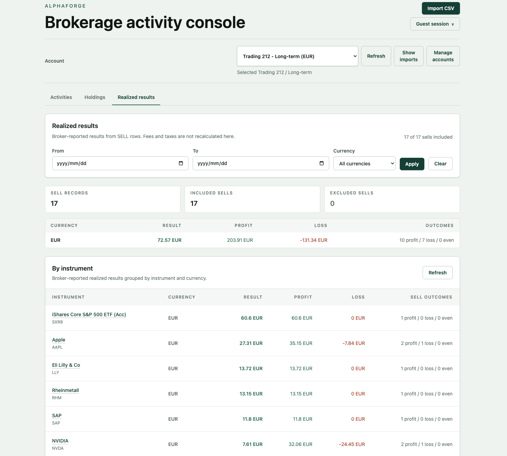
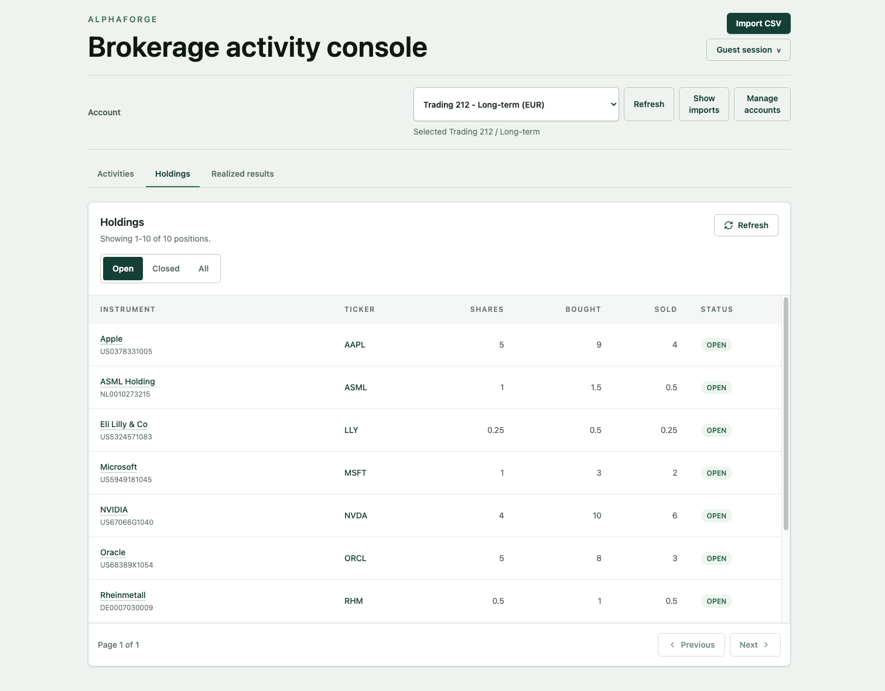
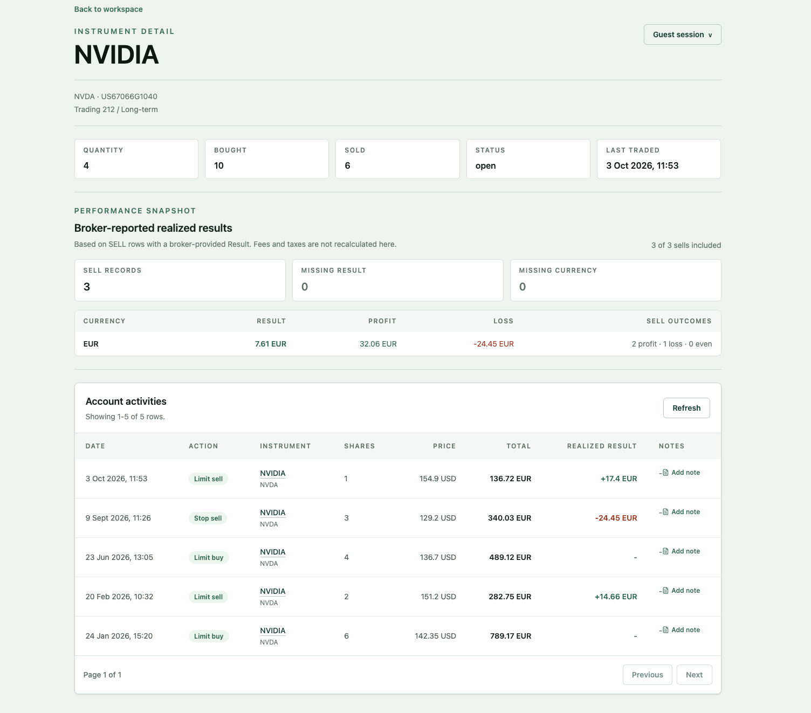
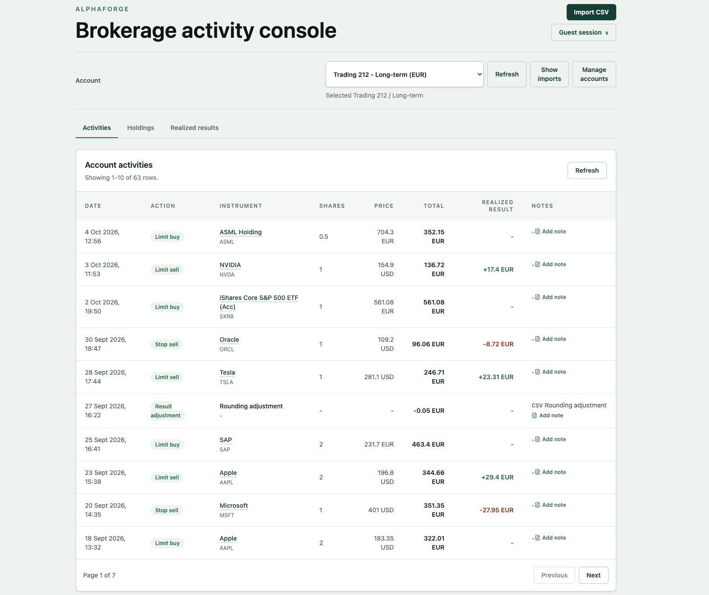
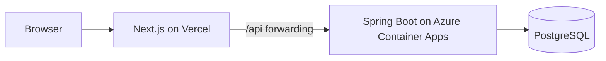

# AlphaForge

AlphaForge turns brokerage CSV exports into a workspace for reviewing transactions,
tracking holdings, summarizing realized trading results, and keeping trade journal
notes. Import your activity once, then explore it by account or individual stock.

[Live demo](https://alphaforge6.vercel.app/) | [Download demo CSV](https://alphaforge6.vercel.app/templates/account-activity-sample.csv) | [Run locally](#run-locally)

## Try the demo

No registration is needed to explore the application:

1. Open the [live demo](https://alphaforge6.vercel.app/) and select **Try as guest**.
2. Select **Add brokerage account** and create an account workspace.
3. Select **Download sample CSV**, then use **Import CSV** to upload it to that account.
4. Explore **Activities**, **Holdings**, and **Realized results**. Click an instrument
   name or ticker to open its individual history and results.
5. Add a journal note to a transaction, or open **Import history** to review the
   upload and undo the latest batch.

The [sample CSV](frontend/public/templates/account-activity-sample.csv) contains
synthetic transactions, including buys, sells, dividends, interest, and card
payments. It can be imported as provided and does not require a broker connection.

Each guest has a separate workspace, limited to 2 brokerage accounts, 10 import
batches, and 5,000 activity rows. A guest upload can contain up to 1,000 rows and
1 MB. Register or sign in to use a registered workspace; guest data is not migrated
to a newly registered account.

## What you can do

| Feature | In the application |
| --- | --- |
| Manage brokerage accounts | Create and delete account workspaces, set a base currency, and switch between accounts. |
| Import and review activity | Upload Trading 212-style CSV exports and browse transactions with dates, instruments, quantities, prices, amounts, and currencies. |
| Track holdings | Review quantities bought, sold, and remaining; filter open, closed, or all positions and browse multiple pages. |
| Explore one instrument | Open a stock's holding, realized results, and paginated activity history, including related dividends. |
| Keep a trade journal | Add, edit, or clear personal notes on individual transactions without replacing notes from the broker export. |
| Review realized results | View account and instrument summaries grouped by currency, with sale-date filters, instrument contributions, and missing-data counts. |
| Manage imports | View filenames, import status, and successful or failed row counts. Undo imports in reverse import order per account. |
| Use guest or registered access | Try the workflow without registration, or create an account and return using email/password sign-in. |

## Core Features in Action

### Account realized results

Review broker-reported results by currency, filter sale dates, and compare each
instrument's contribution to the account's realized result.



<details>
<summary>Holdings: open and closed positions</summary>

Review remaining shares alongside total quantities bought and sold. Switch
between open, closed, or all positions and navigate to an instrument's history.



</details>

<details>
<summary>Instrument details: holdings, realized results, and trade history</summary>

Explore an individual stock's remaining position, broker-reported realized
results, and buy/sell history. Add journal notes directly to its transactions.



</details>

<details>
<summary>Account activities and trade journal</summary>

Browse imported transactions with quantities, prices, currencies, and realized
results. Add a personal journal note to any activity.



</details>

## Import integrity

An import is checked against the selected account's existing activity as well as
other rows in the same file. Checks cover identical files, duplicate or conflicting
transaction IDs, ambiguous overlaps without IDs, unsupported actions, and missing
trade identifiers. Dates are validated strictly rather than silently adjusted.

Buy and sell history is replayed chronologically. An import that would create
negative holdings is rejected, and deleting a batch rechecks the remaining history.
Imports and related account changes acquire the same user's database write lock
to prevent concurrent operations from bypassing these checks.

Duplicate/conflict, action/identifier, and holding-validation failures reject the
whole import transaction. Ordinary field-mapping errors can produce a partial
import: valid rows are saved and invalid rows are reported with their row and
column. Review the returned import status and error details before using a
partial history for analysis. See [import rules](docs/import-integrity.md).

## Technology and deployment

| Area | Stack |
| --- | --- |
| Backend | Java 21, Spring Boot, Spring MVC, Spring Data JPA, Spring Security |
| Database | PostgreSQL 16, Flyway migrations, Spring Session JDBC |
| Frontend | Next.js, React, TypeScript, TanStack Query, Tailwind CSS |
| Validation and tests | Apache Commons CSV, Bean Validation, JUnit, Mockito, Testcontainers, Node.js tests |
| Hosting and delivery | Vercel frontend, Docker backend on Azure Container Apps, Azure Database for PostgreSQL, GitHub Actions, GHCR |



Guests and registered users share session-based authentication and the same
business APIs. Account access is checked against the current user. Production
uses HttpOnly session cookies, CSRF protection for writes, authentication rate
limits, and guest resource quotas. Business records and server-side sessions are
stored in PostgreSQL.

See the [architecture guide](docs/architecture.md) for package responsibilities,
authentication, import transactions, calculation rules, and frontend caching.

## Run locally

Requirements: **JDK 21**, **Node.js 24**, and **Docker with Docker Compose**.
The repository includes the Maven Wrapper; a separate Maven installation is not
required. Start Docker before running the database or backend integration tests.

Clone the repository:

```sh
git clone https://github.com/KehangLi/AlphaForge.git
cd AlphaForge
```

Start PostgreSQL and the backend from the repository root:

```sh
docker compose up -d postgres
./mvnw spring-boot:run -Dspring-boot.run.profiles=local
```

In a second terminal, start from the repository root and run the frontend:

```sh
cd frontend
npm ci
npm run dev
```

Open [http://localhost:3000](http://localhost:3000) and select **Try as guest** or
**Create account**. The backend listens on port **8080** and provides a basic
process check at [http://localhost:8080/health](http://localhost:8080/health).
The development database uses port **5432**. These instructions assume those
ports are available.

The default local database settings in `compose.yml` and the `local` Spring
profile match, so a fresh clone can run without creating environment files.
Guest entry and registration create separate workspaces. The optional local
seed user is not automatically signed in and has no login password by default.

Follow the [full local development guide](docs/local-development.md) for seed-user
login, environment overrides, database inspection, Postman requests, shutdown,
and troubleshooting. Docker Compose reads a root `.env`; Spring Boot does **not**
automatically load that file. Local example credentials are for development only.

## Verification

From the repository root:

```sh
# Compile, test, and package the backend. Docker must be running.
./mvnw verify

# Run the frontend tests, linting, and production build.
npm --prefix frontend test
npm --prefix frontend run lint
npm --prefix frontend run build
```

Backend integration tests run Flyway and JPA against disposable PostgreSQL
containers, rather than the development database. Coverage includes session and
ownership checks, import validation, concurrent writes, transaction rollback,
holdings, and realized results. Frontend tests cover API requests, session changes,
proxy headers, and mutation-driven cache invalidation.

The general CI and security workflows are currently started manually through
GitHub Actions. The versioned backend release workflow tests the source, builds
and scans the exact AMD64 image, blocks HIGH/CRITICAL findings, publishes it to
GHCR, and verifies deployment to Azure. See [testing](docs/testing.md),
[security checks](docs/security-checks.md), and [releases](docs/backend-release.md).

## Current scope

- **CSV support:** the current importer targets the English Trading 212-style
  activity format shown in the sample. Other broker formats and unsupported
  corporate actions require additional mapping and validation.
- **Holdings:** quantities are derived from imported buy/sell history. Missing
  opening positions or earlier purchases must be supplied before importing sales
  that would otherwise create a negative balance. ISIN takes precedence over
  ticker; ticker-only history is not automatically merged with ISIN-backed history.
- **Results:** realized summaries aggregate the broker's `Result` values from
  sell rows, grouped by currency. Missing results or result currencies are reported
  separately. The application does not calculate tax lots or convert different
  currencies into a single return, and does not recalculate fees and taxes.
- **Market data:** live prices, current market values, and unrealized profit/loss
  are not included.
- **Guest lifecycle:** access is tied to the guest session. Session expiry or
  logout does not automatically delete stored guest records; scheduled cleanup
  and guest-to-registered data migration are not implemented.
- **Account recovery:** Google sign-in, email verification, and password reset
  are not implemented.

## Documentation

Start with the [documentation index](docs/README.md) for the complete guide map.

| Goal | Guide |
| --- | --- |
| Run and develop locally | [Local development](docs/local-development.md), [frontend guide](frontend/README.md) |
| Understand the design | [Architecture](docs/architecture.md), [database schema](src/main/java/com/likehang/alphaforge/model/entity/schema.md) |
| Understand authentication and data rules | [Sessions and CSRF](docs/authentication.md), [import integrity](docs/import-integrity.md), [abuse protection](docs/abuse-protection.md) |
| Work with analysis APIs | [Holdings](docs/holdings-api.md), [instrument detail and journal](docs/instrument-api.md), [account results](docs/account-realized-trading-api.md) |
| Verify changes | [Backend tests](docs/testing.md), [security checks](docs/security-checks.md) |
| Deploy and release | [Production configuration](docs/production-configuration.md), [Vercel](docs/frontend-deployment.md), [Docker](docs/containerization.md), [release and rollback](docs/backend-release.md) |
