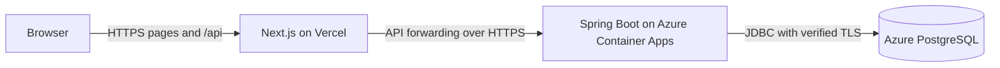
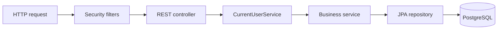

# Architecture

[Documentation](README.md) | [Local development](local-development.md) | [Database schema](../src/main/java/com/likehang/alphaforge/model/entity/schema.md)

AlphaForge is a monorepo containing a Next.js frontend and a Spring Boot backend.
The backend is a single application with layers for HTTP, business services,
CSV parsing, and persistence. PostgreSQL stores both business records and
server-side sessions. Holdings and realized summaries are calculated from
imported activity when requested.

## Runtime topology

In production, the browser sends API requests to its frontend origin. Next.js
rewrites `/api/:path*` to `BACKEND_ORIGIN`, retaining the path. This keeps
browser-facing authentication on one domain. API responses opt out of HTTP
caching; TanStack Query manages the application's client-side data cache.

`frontend/src/proxy.ts` runs for `/api` requests. On Vercel, it replaces incoming
application-specific forwarding headers with the platform's client IP and a
server-only `TRUSTED_PROXY_SECRET`. `ClientIpResolver` accepts that forwarded
address only when the secret matches; otherwise it uses the direct peer address.
This supports IP rate limits. It does not replace user authentication or require
all direct requests to the Azure origin to present the proxy secret.

Locally, `next dev` serves port `3000` and the browser calls the backend on
`8080` directly. CORS allows that frontend origin, and PostgreSQL runs in Docker
on `5432`. The production forwarding secret is unnecessary for this local path.
See [local development](local-development.md) and [proxy configuration](abuse-protection.md#trusted-client-addresses-through-vercel).

## Repository layout

| Location | Responsibility |
| --- | --- |
| `frontend/src/app` | Next.js routes, root layout, and shared QueryClient provider |
| `frontend/src/features` | Authentication, account workspace, holdings, instrument detail, and realized-results UI, queries, and API contracts |
| `frontend/src/lib/api` | Shared request client, cookie/CSRF handling, API errors, and proxy headers |
| `src/main/java/com/likehang/alphaforge/rest` | Controllers and request/response DTOs; HTTP validation, current-user resolution, and pagination bounds |
| `.../service` | Business workflows, authorization checks, transaction boundaries, write locking, and guest quotas |
| `.../csv` | File reading/hashing, CSV headers and row DTOs, parsing, and mapping into activities |
| `.../service/holding`, `.../service/trading` | Holding replay and broker-reported realized-result calculations |
| `.../repository` | Spring Data JPA queries and compact projections for calculation reads |
| `.../model` | JPA entities, supported activity actions, user types, and holding filters/statuses |
| `.../config`, `.../security`, `.../exception` | Spring wiring, profiles, authentication, rate limits, and application exceptions |
| `src/main/resources/db/migration` | Ordered Flyway schema migrations |
| `src/test`, `frontend/**/*.test.ts` | Backend unit/integration tests and frontend request/cache tests |
| `.github/workflows`, `scripts` | Quality/security checks, image builds, versioned releases, and rollback helpers |

The `.../` backend paths share the `src/main/java/com/likehang/alphaforge` prefix.
CSV row DTOs describe external text data; REST DTOs describe API contracts.
JPA entities describe persisted state. Controllers return response DTOs rather
than exposing entity relationships as JSON.

Useful source entry points:

| Flow | Start reading |
| --- | --- |
| Account workspace | [Workspace hook](../frontend/src/features/brokerage-accounts/hooks/use-brokerage-workspace.ts), then [query/mutation hooks](../frontend/src/features/brokerage-accounts/queries.ts) |
| Authentication | [Security configuration](../src/main/java/com/likehang/alphaforge/config/SecurityConfig.java), [auth controller](../src/main/java/com/likehang/alphaforge/rest/controller/AuthController.java), then [session service](../src/main/java/com/likehang/alphaforge/service/UserSessionService.java) |
| CSV import | [Activity controller](../src/main/java/com/likehang/alphaforge/rest/controller/BrokerageAccountActivityController.java), then [import service](../src/main/java/com/likehang/alphaforge/service/AccountActivityCsvImportService.java) and [parser](../src/main/java/com/likehang/alphaforge/csv/AccountActivityCsvParser.java) |
| Portfolio reads | [Holding query service](../src/main/java/com/likehang/alphaforge/service/HoldingQueryService.java), [instrument query service](../src/main/java/com/likehang/alphaforge/service/InstrumentQueryService.java), and [account realized query service](../src/main/java/com/likehang/alphaforge/service/AccountRealizedTradingQueryService.java) |

## Request and identity flow

1. `GET /api/auth/csrf` obtains a CSRF token and can create an anonymous session.
2. A guest, registration, or login POST includes that token and its session cookie.
   Password login uses `AuthenticationManager`, `AppUserDetailsService`, and the
   configured PBKDF2 password encoder.
3. `UserSessionService` replaces the old session and saves an authenticated
   `SecurityContext` through `HttpSessionSecurityContextRepository`. Spring
   Session JDBC persists the session and sends `ALPHAFORGE_SESSION` via
   `Set-Cookie`; the controller returns only the user response body.
4. Later requests include that cookie. Security restores the identity and checks
   authentication and, for writes, CSRF. The client obtains a fresh CSRF token
   after a session change and reuses it within that session.
5. Controllers obtain the current user from `CurrentUserService` and pass its
   UUID to services. Services scope account lookup and data queries to the owner.
   A URL's account UUID selects a resource; it does not establish identity.
6. Logout invalidates the current session and clears its cookie. Other sessions
   remain active. Guest and registered users use the same business endpoints.

The browser manages the HttpOnly cookie. The frontend retains the CSRF token in
memory and does not persist credentials or tokens in local storage. Local seed
data is independent of this flow and never bypasses session checks.

Filter failures use `SecurityErrorHandler`; business/controller exceptions use
`RestExceptionHandler`. Both produce JSON error responses. Request limits may
reject a request before the controller executes. See [authentication](authentication.md)
and [abuse protection](abuse-protection.md).

## Import and write consistency

`AccountActivityCsvImportService.importCsv` coordinates an import in a database
transaction:

1. Apply the per-user upload rate limit and lock the owning `app_user` row.
2. Resolve the selected account by account ID and owner; check guest import
   allowance, file size, and the account's existing file hash.
3. Create the import batch. Parse the CSV into row DTOs, map activities, and
   enforce row and activity quotas.
4. Compare incoming activities with existing and earlier incoming rows for
   duplicate/conflicting IDs and ambiguous content overlaps.
5. Replay existing and incoming trades chronologically to reject negative holdings.
6. Save valid activities, update batch counts/status, and return row error details.

Unsupported actions, missing trade identifiers, duplicate/conflict validation,
and holding-integrity failures reject and roll back the import. Ordinary field
mapping errors can produce `COMPLETED_WITH_ERRORS`: valid rows persist while
invalid rows are reported. Raw uploaded files are not retained as file objects;
the database stores mapped activity, filenames, hashes, and batch metadata.

Account creation/deletion, import/batch deletion, and journal edits acquire the
same owner's write lock within their transaction. Cooperating writes for that
user serialize until commit or rollback; reads and other users remain independent.
Locking a user does not automatically lock every child row or an unrelated code
path that ignores this convention. The coarse lock is a deliberate MVP tradeoff:
different accounts belonging to the same user also serialize.

Database unique indexes additionally protect account/file hashes and nonblank
account/transaction IDs. Batches get a database-generated `import_sequence`.
Only the latest batch in an account can be hard-deleted, and deletion revalidates
the remaining holdings before removing activities and their journal notes.
See [import integrity](import-integrity.md) for exact duplicate and deletion rules.

## Read models and calculations

| Query | Data and calculation |
| --- | --- |
| Account activities | Database-paged entities mapped to `AccountActivityResponse` |
| Holdings | Compact trade history projected from the database, then replayed by `HoldingCalculator`; filter and page the calculated positions |
| Instrument detail | Projected full instrument history for metadata, holdings, and realized results, plus a database-paged activity list |
| Account realized results | Projected sale history for the selected UTC date range; group and page instrument/currency contributions in Java |

`TradeActivitySupport` prefers normalized ISIN, falling back to ticker when ISIN
is missing. `ISIN:...` and `TICKER:...` identities are separate. Supported buy/sell
actions change share quantities; dividends do not add shares.
`RealizedTradingCalculator` sums the broker's sell `Result` values per currency,
with separate missing-data counts. It does not infer cost lots, convert
currencies, fetch market prices, or calculate unrealized returns.

Summary calculations use the complete relevant history before slicing response
pages. A small page does not imply a small history read. Instrument detail and
account realized-summary services use read-only `REPEATABLE_READ` transactions
to keep their component reads consistent. These reads do not acquire the user
write lock, and there are no persisted holding/summary tables.

## Frontend state and cache

Routes delegate to feature components. Feature `api.ts` files describe HTTP
calls, `queries.ts` defines TanStack Query hooks/keys and mutation invalidation,
and `types.ts` defines response shapes. React state holds UI choices such as
the selected account, tab, filter, page, and dialog state.

Query keys include the relevant account, instrument, filters, and pagination.
After an import or batch deletion, related activity, import, holding,
instrument, and realized-result queries are invalidated. Account deletion removes
its cached views. Journal edits refresh activity and instrument details.

Identity changes cancel outstanding queries and clear the prior workspace cache.
Mutation callbacks verify the initiating identity before updating cached data.
A CSRF/session-change failure triggers session verification and asks the user
to retry; the client does not automatically replay writes.
See the [frontend guide](../frontend/README.md) for source entry points.

## Schema and environment boundaries

Flyway owns schema evolution; Hibernate uses `ddl-auto: validate`. Applied
migrations remain in place, and new versions evolve the same database. Four
business tables form the user/account/batch/activity graph. Two additional
Spring Session tables persist authentication state; they are managed by the
framework rather than application JPA entities. See the [schema and migration map](../src/main/java/com/likehang/alphaforge/model/entity/schema.md).

`local`, `test`, and `prod` use separate database configuration. Integration tests
receive disposable PostgreSQL connections through Testcontainers and never
fall back to the local database. Production requires explicit database settings,
verified database TLS, secure cookies, and a shared server-side proxy secret.

Rate limits are currently in memory, so deployments use one active backend
replica. A shared limiter is needed before scaling across replicas. PostgreSQL
sessions persist separately from that limiter. Guest expiry/logout does not
automatically delete guest business data.

The backend release workflow tests, builds, scans, and publishes a versioned
AMD64 image to GHCR, then deploys its digest to Azure. Vercel manages frontend
deployment separately. General CI and security scans are currently manual
workflows. [Release and rollback](backend-release.md) documents the exact process;
rolling back an application image does not undo Flyway migrations.
