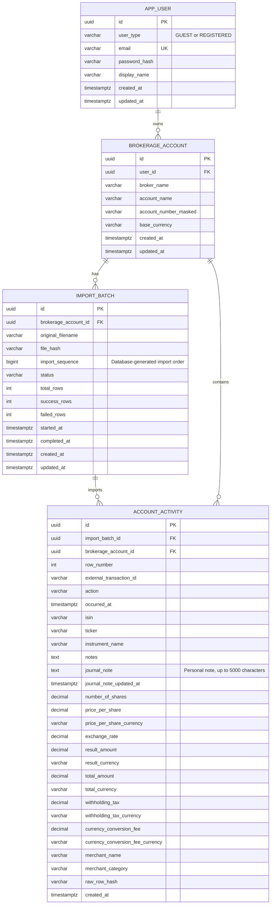
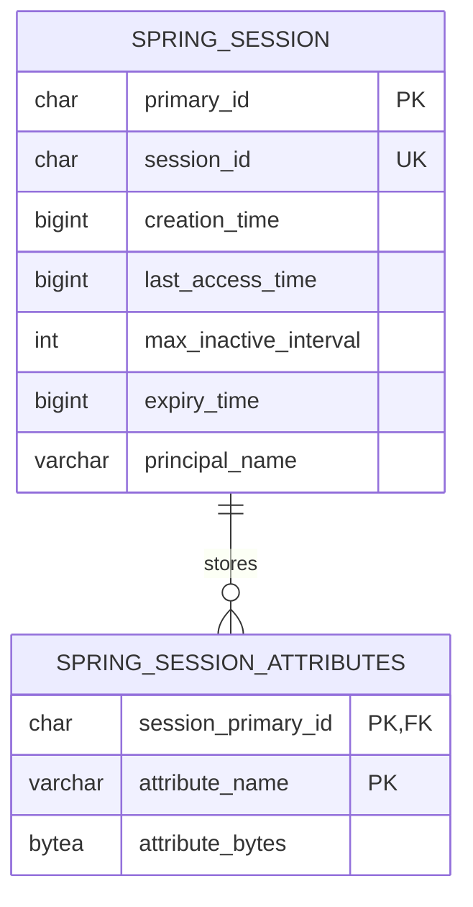

# Database schema

[Documentation](../../../../../../../../docs/README.md) | [Architecture](../../../../../../../../docs/architecture.md)

The diagram shows the business schema after migrations V1-V6. UUID primary keys
identify business records; foreign keys enforce their relationships.

## Relationships and constraints

- A user owns multiple brokerage accounts. Each account has its own imports and
  activities; resource access is checked against the session user.
- Each activity belongs to one import batch and one brokerage account. Keeping
  the account reference supports direct account-scoped queries. The import
  service assigns both references from the selected account.
- Account-scoped unique indexes reject duplicate file hashes and duplicate
  nonblank external transaction IDs. Content-overlap checks also run in the
  import service; they are not represented by a content uniqueness constraint.
- `import_sequence` determines import order for latest-first deletion and
  deterministic replay. It is separate from the activity's trading timestamp.
- `notes` comes from the broker CSV. `journal_note` and its edit timestamp are
  user-managed fields on the same activity; deleting the activity deletes its note.
- Registered emails are unique after trimming/lowercasing. Guest email and
  password hash can be null; guests cannot have a password hash.

Batch and account deletion are hard deletes coordinated by services within a
transaction. The business foreign keys do not declare automatic delete cascades.
There are no separate holding, realized-summary, instrument, or journal tables.

## Session storage

Spring Session JDBC uses two additional tables created by Flyway V3:

Spring manages these records without application JPA entities. Authenticated
sessions use the user's UUID as `principal_name`, but it is not a database
foreign key to `app_user`; anonymous sessions can also exist. Attributes persist
the security context and other session state. The session-attribute foreign key
uses `ON DELETE CASCADE`.

## Migration map

| Migration | Purpose |
| --- | --- |
| [V1](../../../../../../resources/db/migration/V1__create_initial_schema.sql) | Four business tables, foreign keys, and initial indexes |
| [V2](../../../../../../resources/db/migration/V2__add_app_user_type.sql) | Guest/registered user type and nullable guest email |
| [V3](../../../../../../resources/db/migration/V3__create_session_tables.sql) | JDBC session and attribute tables |
| [V4](../../../../../../resources/db/migration/V4__add_password_credentials.sql) | Password hashes and normalized email uniqueness |
| [V5](../../../../../../resources/db/migration/V5__enforce_import_integrity.sql) | Account-scoped import uniqueness and import sequence, including historical backfill |
| [V6](../../../../../../resources/db/migration/V6__add_activity_journal_notes.sql) | Journal note, edit timestamp, and note-length constraint |

Flyway records applied versions in `flyway_schema_history`. Hibernate validates
the migrated schema with `ddl-auto: validate`; it does not create these tables.
